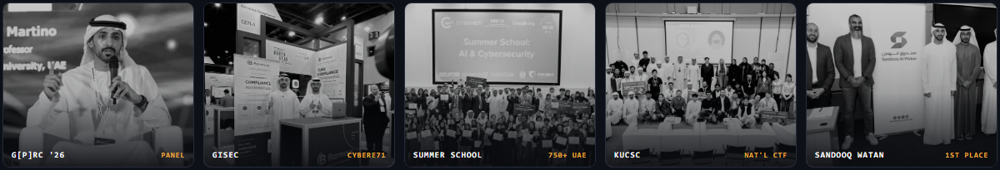

### Salaam, I'm Zayed.

I build AI security tools, compliance software, and low-level systems in Abu Dhabi while finishing up my CS degree at Khalifa University. Previously worked in Group Risk Management at First Abu Dhabi Bank (FAB) and hold an ISO 27001 Lead Auditor cert.

**What I'm working on:**
- **[Barmous](https://barmous.ae):** AI-assisted compliance software for UAE & global security frameworks (CyberE71 & AWS backed).
- **[Nemu](https://nemu.ae/):** B2B growth and outbound systems.
- **[KUCSC](https://kucsc.net):** Advisor (past President) at KU's Cybersecurity Club. Scaled the club from 0 to 850+ students across the UAE with the Cyber Security Council and Google.org.

**Code worth checking out:**
- **[murqab](https://github.com/al9eri/murqab)** (Rust, Python): MCP security proxy and `.docx`/`.pdf` scanner that catches prompt injections, tool rug-pulls, and secret leaks in ~55 µs.
- **[ku-elearn-companion](https://github.com/al9eri/ku-elearn-companion)** (Rust, Python): Desktop command center and native Rust MCP server for Khalifa University courses, grades, and slide search.
- **[Ai_Security_Ledger_Project](https://github.com/HaLTic/Ai_Security_Ledger_Project)** (Python): Seven-layer fail-closed security architecture with an independent AI Guardian, price replay, and SHA-256 hash-chained audit logs.
- **[pulse-edge-ai](https://github.com/al9eri/pulse-edge-ai)** (C, TinyML): On-device PPG filtering and quantized anomaly detection running live on an ESP32-S3.
- **[systems-and-algorithms](https://github.com/al9eri/systems-and-algorithms)** (C11): POSIX threads, System V shared memory, and raw TCP sockets from scratch.
- **[rip-network-automation](https://github.com/al9eri/rip-network-automation)** (Python): Fault-injection and failover timing harness for Cisco RIPv2 routers.

1st Place at **Sandooq Al Watan**, **Tawazun Security Hackathon**, and **NYUAD Game Jam**.

  

[LinkedIn](https://www.linkedin.com/in/zayedalnuaimi) · [barmous.ae](https://barmous.ae) · [nemu.ae](https://nemu.ae/) · [kucsc.net](https://kucsc.net)
