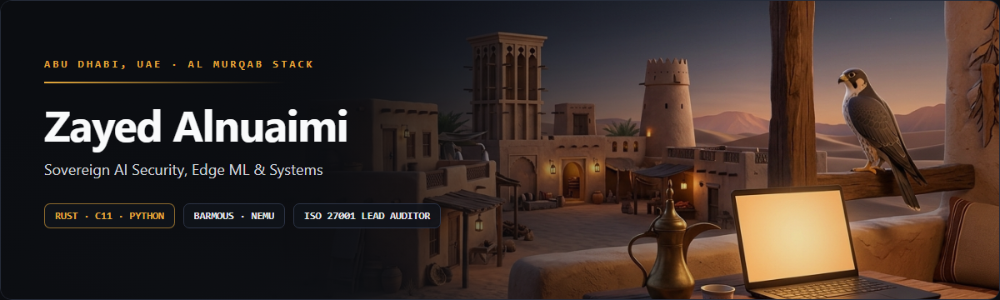
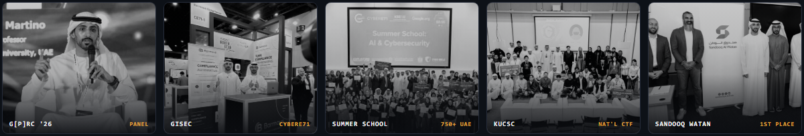

  

Founder & CEO at [Barmous](https://barmous.ae) · Co-Founder & CEO at [Nemu](https://nemu.ae/).  
Previously Group Risk Management (Bedaya) at **First Abu Dhabi Bank (FAB)** · **ISO/IEC 27001:2022 Lead Auditor**.  
1st Place **Sandooq Al Watan** · 1st Place **Tawazun Security Hackathon** · 1st Place **NYUAD Game Jam**.

#### Engineering

- **[murqab](https://github.com/al9eri/murqab)** — Bidirectional Rust + `PyO3` MCP `stdio` firewall (`murqab mcp-proxy`) with SHA-256 `tools/list` rug-pull pinning, session taint guard (`-32002`), egress secret DLP (`-32003`), and `.docx`/`.pdf` stealth-text unpacking (`<w:vanish/>`, PDF `3 Tr`, `~55 µs`/doc).
- **[pulse-edge-ai](https://github.com/al9eri/pulse-edge-ai)** — On-device PPG signal conditioning (`C` causal `sosfilt`, `1.7e-9` scipy parity), `Int8` 1D-CNN anomaly detection (`0.706` PR-AUC, `1.5 ms/win`), and FreeRTOS telemetry on `ESP32-S3` + `MAX30102`.
- **[systems-and-algorithms](https://github.com/al9eri/systems-and-algorithms)** — POSIX concurrency (`pthreads`, counting semaphores, mutexes), System V shared-memory IPC (`shmget`/`shmat`), and raw `AF_INET` TCP sockets in `C11`.
- **[rip-network-automation](https://github.com/al9eri/rip-network-automation)** — Deterministic Cisco IOS RIPv2 fault-injection and routing convergence measurement harness (`~25.5 s` failover recovery) over SSH/Netmiko.

#### Ventures & Ecosystem

- **[Barmous Compliance](https://barmous.ae)** — AI-assisted, human-approved GRC platform across 7 live regulatory frameworks (`UAE IA`, `ADHICS`, `ISO 27001`, `ISO 42001`, `NIST CSF`, `UAE PDPL`). Backed by **CyberE71** & **AWS Cybersecurity Accelerator**; showcased at **G[P]RC Summit 2026**, **GISEC 2026**, and **Make it in the Emirates**.
- **[Nemu Technologies](https://nemu.ae/)** — Automated B2B revenue and customer acquisition infrastructure.
- **[KU Cybersecurity Club (KUCSC)](https://kucsc.net)** — Founder & Strategic Advisor (formerly President). Scaled the AI & Cyber Security Summer School to **750+** participants across all 7 Emirates alongside the **UAE Cyber Security Council** and **Google.org**.

  

[LinkedIn](https://www.linkedin.com/in/zayedalnuaimi) · [barmous.ae](https://barmous.ae) · [nemu.ae](https://nemu.ae/) · [kucsc.net](https://kucsc.net)
