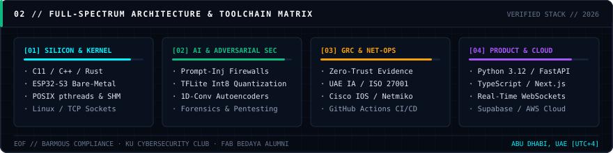

  <!-- TACTICAL COMMAND HUD & LIVE EDGE TELEMETRY -->
  

    

  <!-- SECTION 01: DEPLOYED SYSTEMS -->
  

   

  <!-- CLICKABLE 2x2 BENTO SPEC-SHEET GRID -->
  

    
    
  

  

    
    
  

   

  <!-- SECTION 02: FULL-SPECTRUM ARCHITECTURE MATRIX -->
  

<code>[EXPAND] // ADDITIONAL REPOSITORIES &amp; VERIFIED BENCHMARKS</code>

 

| System / Repository | Architecture & Domain | Key Engineering Proof |
| :--- | :--- | :--- |
| **[`pulse-edge-ai`](https://github.com/al9eri/pulse-edge-ai)** | `ESP32-S3` · `C++` · `TFLite Int8` | `0.706 PR-AUC` 1D-Conv Autoencoder (`1.5 ms/win`, `4 MB Int8`), C `sosfilt` bandpass (`1.7e-9` parity), `68 KB` Flash WebSocket UI |
| **[`aegis-prompt-guard`](https://github.com/al9eri/aegis-prompt-guard)** | `Python` · `AI Security` · `GRC` | Zero-dependency byte-level firewall catching Trojan Source bidi, Plane-14 tag smuggling, Base64 smuggling & compliance-verdict coercion |
| **[`rip-network-automation`](https://github.com/al9eri/rip-network-automation)** | `Cisco IOS` · `Netmiko SSH` · `Python` | Automated router orchestration, 1 Hz routing snapshots, millisecond debug-log parser & deterministic offline IOS RIPv2 simulator |
| **[`systems-and-algorithms`](https://github.com/al9eri/systems-and-algorithms)** | `C11` · `pthreads` · `SysV SHM` | Multi-barber POSIX semaphores, `shmget/shmat` IPC across `fork()`, `AF_INET` TCP sockets & $O(n \log n)$ Divide & Conquer kernels |
| **[`diabetes-risk-ml`](https://github.com/al9eri/diabetes-risk-ml)** | `Scikit-Learn` · `Pandas` · `Jupyter` | Clinical risk classification pipeline with stratified evaluation, sensitivity/ROC-AUC optimization & feature attribution |
| **[`rustlings`](https://github.com/al9eri/rustlings)** | `Rust` · `Cargo` | Ownership, lifetimes, zero-cost abstractions, fearless concurrency & type-safe systems exercises |
| **[`emirati-tower-defense`](https://github.com/al9eri/emirati-tower-defense)** | `HTML5 Canvas` · `Vanilla JS` | Zero-dependency 60 FPS browser strategy engine with custom entity state machines and wave progression |

